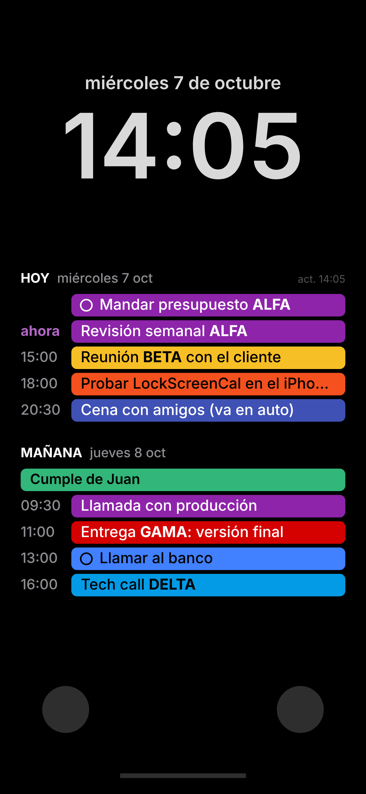

# LockScreenCal

Tu calendario y tus tareas de los próximos días en el lock screen del iPhone, con
colores y fondo negro. No es una app del App Store: es un **Atajo** de iOS más la
app gratis [Scriptable](https://apps.apple.com/app/scriptable/id1405459188), que
dibuja el fondo de pantalla con tus eventos.



(Datos de ejemplo. El reloj y los botones los pone el iPhone.)

- Muestra hoy, mañana y los días que sigan, **hasta donde entre**. Los días sin
  eventos no ocupan lugar.
- Cada evento es una caja de su color, con el texto en negro o blanco según qué se
  lea mejor. Las tareas llevan un circulito adelante, como en Todoist.
- Las palabras que elijas (por ejemplo, nombres de proyectos) salen en negrita.
- El dibujo y los calendarios del iPhone se procesan en el teléfono. En la
  instalación independiente, Google y Todoist se consultan desde ahí; en la
  implementación administrada se preparan en un servicio con acceso protegido.
- El código se actualiza desde GitHub sin reinstalarlo. El cargador guardado
  reutiliza su copia durante cinco minutos.

**¿Por qué un fondo y no un widget?** En el lock screen, iOS muestra los widgets en
blanco y negro. La única forma de tener colores es el fondo de pantalla (lo mismo
hacen apps como Ink).

---

## Elegir la instalación

| Qué querés usar | Guía |
|---|---|
| Instalarlo en otro iPhone con los calendarios de esa persona | [Instalación independiente](#instalar-la-versión-independiente), abajo |
| Mantener la implementación administrada existente, con datos preparados y salida PNG | [Instalación administrada](docs/Instalacion-administrada.md) |
| Pasárselo a un amigo sin tus cuentas ni ajustes | [Guía para compartir](docs/Compartir.md) |

**El servicio administrado actual está configurado para una sola cuenta.**
No hay alta automática de amigos ni un enlace de Atajo listo para importar.
El repo ofrece el cargador limpio y los pasos manuales. Copiar el Atajo actual
no instala el script guardado, el Keychain ni el servicio en otro teléfono.

## Instalar la versión independiente

Los nombres de botones de esta guía son los de un iPhone en castellano con iOS 26.
Si en tu versión algo se llama distinto, buscá la palabra que se indica.

### 1. Lo previo

1. Instalá **[Scriptable](https://apps.apple.com/app/scriptable/id1405459188)** y abrila una vez.
2. Si usás Google Calendar, la cuenta tiene que estar agregada en el iPhone: en
   **Ajustes**, buscá **Cuentas** con la lupa y agregá tu cuenta de Google con
   **Calendarios** prendido.
3. Creá un lock screen negro para el calendario: mantené apretado el lock screen →
   **+** → **Color** → negro. (Si ya tenés uno negro, sirve ese.)

### 2. El Atajo

En la app **Atajos** → pestaña **Atajos** → **+**.
Cada acción se agrega escribiendo en la barra **Buscar acciones**:

1. Escribí **Scriptable** y elegí **Run Inline Script**. En el atajo se ve como
   **"Run with Parameter"**. Tocá la flechita **›**, borrá el código de ejemplo y
   pegá todo el contenido de [`loader.js`](loader.js).
2. Escribí **Base64** y agregá la acción. Tocá la palabra **Codificar** y cambiala a
   **Decodificar**. Tiene que quedar **"Decodificar Output con base64"**.
3. Escribí **fondo** y elegí **Establecer foto como fondo de pantalla** (ícono azul
   de flor). **No** "Cambiar entre fondos de pantalla", que solo alterna fondos.
   Tiene que quedar **"Establecer Codificado con Base64 como … en Pantalla
   bloqueada"**. Si dice "Pantalla bloqueada y Pantalla de inicio", tocalo y dejá
   solo **Pantalla bloqueada**.
4. **Elegir el fondo:** en esa misma acción, tocá el fondo (dice algo como
   "3 fondo de pantalla") y marcá el lock screen negro del paso 1.3. Ese es el que
   el Atajo va a ir pisando.
5. Tocá la flechita **⌄** de esa acción y **apagá "Mostrar vista previa" y
   "Recortar sujeto"**.
6. En la primera acción ("Run with Parameter"), tocá la **›**, bajá hasta debajo de
   "Texts" y "URLs" y **apagá "Mostrar al ejecutar"**. Si no, cada vez que corre
   aparece un cartel con un ✓ y un botón "Listo".
7. Ponele un nombre arriba (ej. **Actualizar calendario**).

### 3. Probar

1. Tocá **▶︎** (abajo a la derecha del editor). La primera vez pide permisos
   (calendario, internet, fondo de pantalla): aceptá todo, y si ofrece "Permitir
   siempre", elegí ese.
2. Bloqueá el teléfono. Si ves otro fondo, mantené apretado el lock screen y elegí el
   negro: el Atajo pinta **el fondo elegido en el paso 4**, no el que esté activo.

Arriba a la derecha del calendario dice `act. HH:MM`: la hora de la última
actualización.

Desde v0.13, si se ejecuta de nuevo antes de un minuto, reutiliza el último fondo
generado con los mismos ajustes. Si hay una actualización en curso, también usa
ese fondo para evitar repetir consultas y dibujos. Si todavía no se generó uno,
entrega un aviso para esperar dos minutos y probar una sola vez. La marca de
ejecución activa vence a los dos minutos si iOS interrumpe el proceso.

v0.23 protege también la descarga del cargador guardado: si ya hay un refresco
de código en curso, las otras llegadas usan la copia disponible. Durante una
actualización puede reutilizar el PNG de la versión anterior si hay otra corrida
activa y los ajustes coinciden. El Atajo sigue disparándose y aplicando ese PNG;
la protección reduce las descargas, consultas y dibujos repetidos.

### 4. Que se actualice solo

iOS no deja compartir automatizaciones: cada uno las arma una vez. En **Atajos** →
pestaña **Automatización** → **+**:

- **Por horario:** elegí la hora (ej. 7:00) y que se repita **diariamente**. En
  **Automatización** elegí **Ejecutar de inmediato** y apagá **Notificar al
  ejecutar**. En "Hacer", tu Atajo. Repetilo para otras horas (iOS no tiene "cada
  hora").
- **Al usar el teléfono:** iOS no tiene disparador de desbloqueo. Lo más parecido es
  la opción **App**: marcá varias apps que uses seguido (WhatsApp, mail, Calendario)
  y que se dispare cuando **se cierran**. Mismo "Ejecutar de inmediato" sin
  notificación. Con 3 o 4 apps alcanza; cada corrida tarda unos segundos y gasta un
  poco de batería.

---

## Ajustes

En la instalación independiente se configura el bloque `MI_CONFIG`, al principio
del código de la primera acción del Atajo. Lo que no pongas usa el valor por
defecto. En la implementación administrada los ajustes quedan en Keychain;
el Atajo final no contiene ese bloque (ver su [guía](docs/Instalacion-administrada.md)). Ejemplo:

```js
const MI_CONFIG = {
  onlyCalendars: ["Trabajo", "Feriados Argentina"],
  keywords: { ALFA: "#8E24AA", BETA: "#F6BF26" },
};
```

| Opción | Para qué |
|---|---|
| `onlyCalendars` | Solo estos calendarios, con el nombre tal cual aparece en la app Calendario. **Recomendado**: sin esto aparecen todos, incluidos los que tengas destildados (feriados de otros países, sugerencias de Siri…) |
| `excludeCalendars` | Calendarios a ignorar |
| `keywords` | Palabras que salen en negrita en los títulos (y con su color, en el estilo de barrita). Distingue mayúsculas y solo toma palabras enteras ("VA" sí, "va" no). Una tarea de Todoist con una etiqueta que esté acá toma ese color |
| `maxDays` | Hasta cuántos días adelante mirar (se dibuja lo que entre). Por defecto 14 |
| `startInDays` | Arrancar N días después de hoy, para probar cómo se ve otra semana. **Volver a sacarlo** después |
| `topPercent` / `bottomPercent` | Espacio libre arriba (reloj, widgets) y abajo (linterna, cámara), en % del alto. Por defecto 33 y 13 |
| `eventStyle` | `"fill"` (por defecto): cada evento como caja de su color. `"bar"`: barrita de color a la izquierda |
| `background`, `textColor`, `mutedColor` | Colores |
| `showUpdated` | Mostrar `act. HH:MM` |
| `googleUrl` | Color de cada evento de Google (ver abajo) |
| `logRemote` | Activa el envío de historial técnico. Por defecto `false`; ver [registros](docs/Logs.md) |
| `logCollector` | Receptor opcional de logs. El servicio administrado existente requiere aprovisionamiento y no admite cuentas nuevas automáticamente |
| `managedData` | Datos preparados en el servicio; por defecto `true`, pero solo se activa con el receptor administrado reconocido y configurado |
| `todoistToken` | Suma las tareas de Todoist (ver abajo) |
| `todoistOnlyMine` | Solo tus tareas o las sin asignar. Por defecto `true` |

Si el mismo evento viene de dos calendarios, sale una sola vez.

## Tareas de Todoist (opcional)

Suma tus tareas con fecha **de hoy en adelante** (las vencidas no), con un circulito
adelante. Las que no tienen hora van arriba de cada día. Color: el de la primera
etiqueta que esté en `keywords`; si no, el del proyecto de Todoist.

Agregá tu token en `MI_CONFIG`. Está en Todoist, en la configuración, sección de
integraciones para desarrolladores ("token de API"):

```js
todoistToken: "tu-token",
```

El token da acceso total a tu cuenta de Todoist: **no compartas el Atajo con el
token puesto**.

**Si usás Akiflow:** cuando le reservás horario a una tarea de Todoist, Akiflow crea
un evento con el mismo nombre en tu Google Calendar. El fondo lo detecta (mismo día y
mismo nombre) y muestra solo la tarea.

## Colores de Google por evento (opcional)

El iPhone sabe el color de cada **calendario**, pero no el color que le ponés a cada
**evento** en Google Calendar. Para traerlo hay un puente chiquito que corre en tu
propia cuenta de Google (Google Apps Script, gratis). Conviene armarlo desde la compu:

1. Entrá a <https://script.google.com> con la cuenta del calendario y creá un
   proyecto nuevo.
2. Borrá lo que hay y pegá [`google/Code.gs`](google/Code.gs).
3. Cambiá `TOKEN` por algo largo y al azar: es la "contraseña" de la URL.
4. En la configuración del proyecto (engranaje), revisá que la zona horaria sea la tuya.
5. **Implementar → Nueva implementación** → tipo **Aplicación web**. Ejecutar como:
   **vos**. Quién tiene acceso: **Cualquier usuario**. Aceptá los permisos de
   Calendar (si dice que la app "no está verificada", es normal: la app sos vos).
6. Copiá la URL que termina en `/exec` y agregala en `MI_CONFIG` con tu token:
   ```js
   googleUrl: "https://script.google.com/macros/s/XXXX/exec?token=TU_TOKEN",
   ```

Con el puente, de Google salen los calendarios que Google conoce (con el color de
cada evento) y del iPhone el resto (por ejemplo, los cumpleaños de los contactos).
`onlyCalendars` filtra las dos fuentes igual.

Si en el paso 5 no aparece "Cualquier usuario", tu cuenta es de una empresa
(Google Workspace) que lo tiene bloqueado: se habilita en la consola de admin.

---

## Si algo no anda

En la implementación administrada, consultar primero los logs remotos: no hace
falta copiar código ni resultados del teléfono. El diagnóstico local de abajo
es una alternativa para instalaciones sin receptor.

| Qué pasa | Qué hacer |
|---|---|
| El lock screen muestra otro fondo | El Atajo pinta el fondo elegido en la acción, no el activo. Mantené apretado el lock screen y elegí ese |
| Aparece un cartel con ✓ y "Listo" cada vez que corre | Apagá **"Mostrar al ejecutar"** en la acción "Run with Parameter" (debajo de "Texts" y "URLs") |
| "Script completed without presenting UI… or outputting a value" | Scriptable terminó sin entregar la imagen; el mensaje no dice la causa. v0.13 reduce las corridas repetidas y guarda la última etapa. Esperá dos minutos y ejecutá una sola vez con internet. Si sigue, consultá el diagnóstico de abajo |
| "Shortcuts no pudo convertir de Texto a NSString" en Base64 | El fallo aparece después de Scriptable. La implementación administrada ofrece salida como archivo PNG desde v0.24 para omitir Base64; ver su guía. Los logs no capturan automáticamente errores de otras acciones de Atajos |
| El fondo sale negro con un error en rojo | Es el error real, escrito para poder leerlo: mandale una captura al que lo mantiene |
| Arriba dice `sin Google` o `sin Todoist` | En la independiente, revisar la URL o el token en `MI_CONFIG`. En la administrada, el mantenedor revisa el snapshot y los logs remotos: puede haber vencido la copia o fallado su consulta. El resto del fondo sale igual |
| Faltan eventos | Revisá que el calendario esté en el iPhone (app Calendario → Calendarios) y que su nombre esté en `onlyCalendars` |
| Sobran eventos (feriados de otros países, etc.) | Poné `onlyCalendars` con solo los que querés |
| Una tarea sale dos veces | Revisá que el evento de Akiflow y la tarea tengan el mismo nombre |
| El reloj o los widgets tapan la lista | Subí `topPercent` (ej. 36) |
| Cambié algo y no se ve | GitHub puede tardar unos 5 minutos en entregar la versión nueva |

### Consultar dónde se cortó

Después del error, sin volver a ejecutar el Atajo:

1. Copiá el código de [`tools/diagnostico.js`](tools/diagnostico.js).
2. Abrí Scriptable, creá un script nuevo y pegalo.
3. Ejecutalo y mandá una captura del texto que muestra al que lo mantiene.

El diagnóstico solo lee el registro local: muestra versión, fecha, última etapa y
tiempo hasta esa etapa. Desde v0.14 también muestra el último intento de salida,
incluidas las corridas que reutilizaron un fondo, y la longitud del PNG en base64.
El estado `ok` indica que el script preparó la salida sin error de JavaScript;
**no confirma que Atajos la recibió**. No incluye tokens, URLs ni eventos. No
vuelve a correr el calendario ni reemplaza el registro. Si no hay registro, puede
estar usando una versión anterior a v0.13, haber fallado antes de iniciar el script
o no haber podido guardar el archivo.

El historial conserva un ID por corrida, etapas, tiempos y tamaños. Con un
receptor configurado, el mantenimiento consulta esos registros desde el servicio,
sin pedir exports al usuario. Ver [Registros y mantenimiento remoto](docs/Logs.md).

La implementación administrada evita esperar a Google/Todoist en el teléfono y
ofrece salida PNG en iCloud desde v0.24. Con `archivo`, Run entrega el archivo
directamente a Establecer fondo: no se agrega Decodificar. La versión independiente
sigue usando base64. Se confirmó funcionamiento silencioso con colores y tareas
en v0.22; una repetición v0.23 falló en Base64. v0.24 tiene pruebas simuladas de
ambos modos y requiere confirmar la nueva entrega en iOS. Ver el
[estado actual](docs/Bitacora.md) antes de diagnosticar o cambiar las acciones.

### Actualizar un cargador anterior a v0.14

Solo para un Atajo **inline antiguo**. No se aplica al script guardado ni a la
migración a archivo PNG de la implementación administrada.

Si el diagnóstico llega hasta la salida y Atajos igual muestra el error, v0.14
cambia cómo el cargador devuelve el PNG: espera que termine la función descargada
y usa `return` al final del código exterior. Esta corrección necesita actualizar
el código del Atajo una vez; descargar solo `LockScreenCal.js` no cambia el
cargador que ya está pegado.

1. En el editor del Atajo, desplegá la primera acción de Scriptable con **›**.
2. Al final del código, reemplazá solo esta línea:
   ```js
   await new AsyncFunction("OVERRIDES", code)(MI_CONFIG);
   ```
   por:
   ```js
   let fondo;
   await new AsyncFunction("OVERRIDES", "Script", code)(MI_CONFIG, {
     setShortcutOutput: valor => { fondo = valor; },
     complete: () => {},
   });
   if (typeof fondo !== "string" || !fondo.startsWith("iVBORw0KGgo")) {
     throw new Error("El script no preparo un PNG valido para Atajos");
   }
   return fondo;
   ```
3. Ejecutá el Atajo una vez. Si sigue fallando, consultá el diagnóstico actualizado.

El retorno está verificado con APIs simuladas y una ejecución manual con el
cargador actualizado funcionó en el iPhone, pero después se reportó un fallo en
Base64. La estabilidad y la causa de los errores todavía no están confirmadas.
El cargador v0.15 registra también descarga y retorno. Si ya está instalado,
las mejoras de v0.16 llegan sin reemplazarlo; ver [la guía de logs](docs/Logs.md).

---

## Pasárselo a otra persona

Pasale este repo y la [guía para compartir](docs/Compartir.md). La instalación
independiente usa sus calendarios, su fondo y, si quiere, sus propias cuentas.

**No dupliques tu Atajo administrado como si fuera una instalación completa:**
su acción Run apunta a un script y a ajustes que viven en tu teléfono. Para
replicar también el servicio preparado hace falta aprovisionar una cuenta
separada y adaptar el servicio; el actual no es multiusuario.

---

## Cómo está hecho

| Archivo | Qué es |
|---|---|
| `LockScreenCal.js` | Dibuja el PNG; conserva salida base64 y contiene el cargador guardado que admite salida como archivo de iCloud |
| `managedAppRunner` / `prepareManagedApp` | Cargador guardado administrado, ajustes en Keychain, caché de código y entrega nativa |
| `loader.js` | Lo que va adentro del Atajo: baja `LockScreenCal.js`, espera que termine y devuelve el PNG con `return`. Sin internet, usa la última copia |
| `google/Code.gs` | El puente opcional con Google Calendar |
| `tools/preview.cjs` | Vista previa en la compu, con datos de ejemplo |
| `tools/diagnostico.js` | Se ejecuta en Scriptable para leer la última etapa después de un corte |
| `google/Logs.gs` | Bloque que se agrega al puente existente para guardar y leer logs técnicos autenticados |
| `tools/ver-logs-google.js` | Consulta los registros recibidos por el puente sin mostrar su token |
| `docs/Compartir.md` | Pasos para otra persona y límites del servicio de una sola cuenta |
| `docs/Instalacion-administrada.md` | Atajo actual, migración a PNG, ajustes, actualizaciones y privacidad |
| `docs/Logs.md` / `docs/Receptor.md` | Telemetría, datos preparados y operación del servicio |
| `docs/Bitacora.md` | Estado del proyecto, decisiones tomadas y problemas conocidos |
| `CLAUDE.md` | Instrucciones para agentes de IA que trabajen en el repo |

Lo que se sube a `main` llega al refrescar el código: en cada corrida del cargador
inline, o al vencer los cinco minutos de caché del guardado. Un error puede romper
el fondo de todos. Antes de subir:

```sh
node --input-type=module --check < LockScreenCal.js
node tools/check-shortcut.cjs   # entrega a Atajos con APIs simuladas
node tools/check-logs.cjs       # historial, reintentos, autenticación y privacidad
node tools/check-deadlines.cjs  # plazos, respuestas tardías, limpieza y SHA-256
node tools/check-app-runner.cjs # script guardado, Keychain, caché y salida nativa
node tools/check-managed-data.cjs # datos preparados, fallback y vencimiento
node tools/check-bursts.cjs     # ráfagas con cargador y programa completos
node tools/check-bursts.cjs --file # ráfagas con entrega PNG como archivo
npm i playwright && npx playwright install chromium
node tools/preview.cjs          # -> preview/preview.png
```
