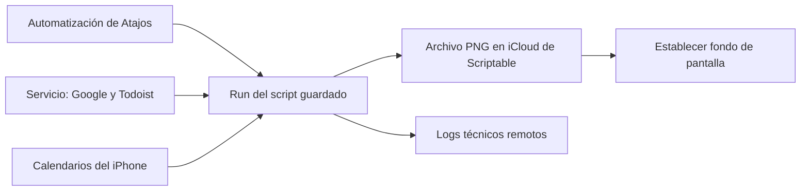

# Implementación administrada

Esta guía describe la implementación aprovisionada actualmente. El servicio
está configurado para una cuenta; para otro iPhone/cuenta ver
[Compartir](Compartir.md). No copiar sus credenciales ni dar por instalado el
script guardado al importar solo un Atajo.

## Requisitos y recorrido

Scriptable, Atajos, permisos de calendario y un fondo elegido en el iPhone.
Para entregar archivos PNG se necesita iCloud habilitado para Scriptable.
Google/Todoist se preparan en el servicio protegido; los calendarios del iPhone
y el dibujo permanecen en el teléfono.

## Atajo final con entrega PNG, desde v0.24

| Orden | Acción | Contenido o conexión |
|---|---|---|
| 1 | Texto | `archivo` |
| 2 | Run Script de Scriptable | Script `LGA_LockScreenCal_App`, Parameter conectado a la salida de Texto |
| 3 | Establecer fondo | Imagen: Output de Run; destino: el fondo elegido, Pantalla bloqueada |

No lleva Decodificar Base64. Dejar **Run In App** y **Mostrar al ejecutar**
apagados en Run; **Always Run in App** apagado en los ajustes del script.
En Establecer, apagar **Mostrar vista previa** y **Recortar sujeto**.
El número del fondo es propio de cada teléfono.

### Migrar el Atajo existente que usa Base64

1. Ejecutarlo primero como está, con Texto `atajo`. Esto descarga v0.24 y
   prepara el cargador guardado actualizado. Si la última descarga fue hace menos
   de cinco minutos, esperar a que venza esa caché antes de hacerlo.
2. Aunque la acción Base64 posterior falle, el script puede haber quedado
   actualizado. El mantenedor verifica versión y `script_start.count` en los
   logs remotos; un fallo de descarga que usa código viejo no confirma actualización.
3. Cambiar el contenido de Texto a `archivo`.
4. Eliminar Decodificar.
5. En Establecer, quitar la variable anterior y seleccionar **Output de Run**
   como imagen. Conservar el fondo elegido y Pantalla bloqueada.
6. Probar una vez. Luego comprobar repeticiones con la automatización habitual.

El parámetro `atajo` conserva la entrega anterior en base64. No alcanza con
cambiar el parámetro si todavía se está ejecutando un cargador guardado anterior
a v0.24. No hace falta pegar código nuevo en Scriptable.

### Conectar las variables en la interfaz observada

Tocar una vez Parameter abre **Archivos**, no el selector de variables. Mantener
pulsado Parameter, elegir **Seleccionar variable** y tocar la salida de Texto.
No escribir `Texto` o `atajo` en el buscador de Archivos.

Una variable roja suele conservar la referencia a una acción eliminada. Quitar
esa referencia y seleccionar la salida de la acción nueva. Para la imagen de
Establecer, elegir Output bajo Run, no Texto ni una salida de Base64 eliminada.
Los gestos se apoyan en la [guía de Apple](https://support.apple.com/es-es/guide/shortcuts/apdd02c2780c/ios).

## Ajustes, actualizaciones y automatizaciones

Los ajustes originales se prepararon desde `MI_CONFIG` del cargador inline y
ahora viven en Keychain, clave `LGA_LockScreenCal.managed.config.v1`. El script
genérico no contiene esos secretos y el Atajo final no tiene `MI_CONFIG`.
Para cambiar ajustes personales hace falta actualizar la configuración local;
no existe todavía una pantalla de configuración remota. No borrar esa clave.

Las mejoras del programa y del cargador guardado llegan desde GitHub. Se conserva
el código durante cinco minutos; si una descarga falla, se usa la última copia
válida. Al ejecutar el programa se reescribe el cargador guardado administrado:
la nueva lógica de ese cargador se usa en una invocación posterior.
Las acciones de Atajos, sus permisos y sus automatizaciones no se editan desde
GitHub ni desde el receptor.

Una ráfaga reutiliza el fondo durante 60 segundos; una actualización en curso
reutiliza la última imagen compatible. La marca activa vence a los 120 segundos
y la de descarga de código a los cinco. Esto reduce consultas y dibujos, pero
Atajos sigue ejecutando la acción de establecer fondo en cada disparo.

## Privacidad y mantenimiento

- Los PNG quedan en `LockScreenCal-output` dentro de los documentos de Scriptable
  en el iCloud del usuario. Contienen los eventos visibles en el fondo.
- Cada corrida crea un nombre propio; otra entrega limpia solo sus PNG de más
  de una hora. No se suben imágenes al receptor técnico.
- El servicio conserva la última copia de Google/Todoist por fuente, con los
  campos necesarios para dibujar y autorización separada. No es solo un receptor
  de logs. Las copias vencen a la hora; se refrescan al recibir solicitudes.
- Los logs contienen ID, versión, etapas, tiempos, cantidades y tamaños; no
  títulos, tokens, imágenes ni mensajes crudos de errores. El mantenedor los lee
  directamente; no se pide al usuario copiar resultados como procedimiento habitual.

[Scriptable documenta](https://docs.scriptable.app/script/) la salida mediante
rutas de archivos de iCloud. Las pruebas de nube verifican bytes PNG, archivos
distintos, fallos de escritura, limpieza y 18 invocaciones con solapamientos.
No prueban el puente nativo de iOS ni confirman que el fondo se aplicó.
La validación real y las limitaciones vigentes están en [Bitácora](Bitacora.md).
